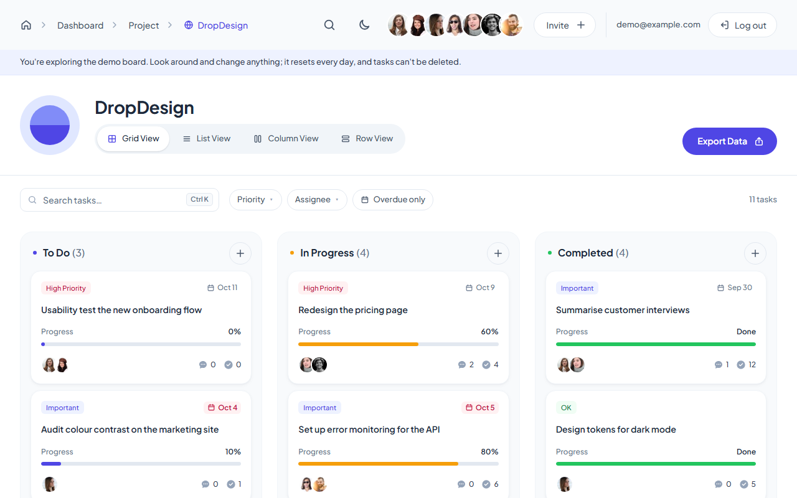
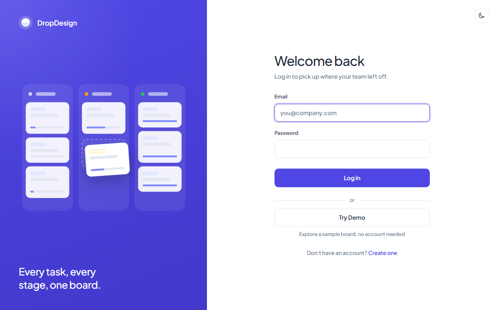
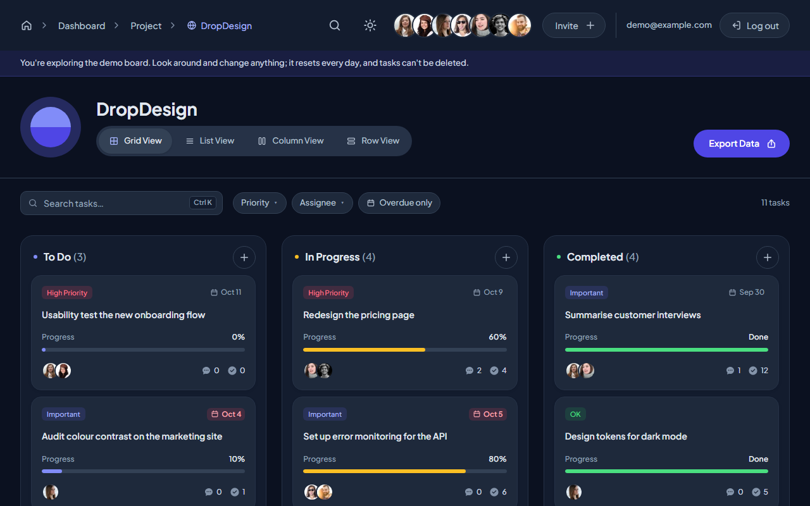
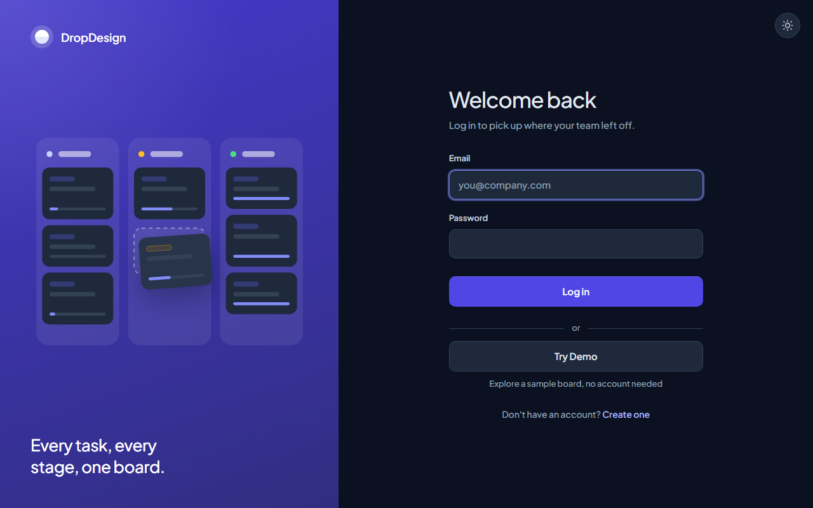
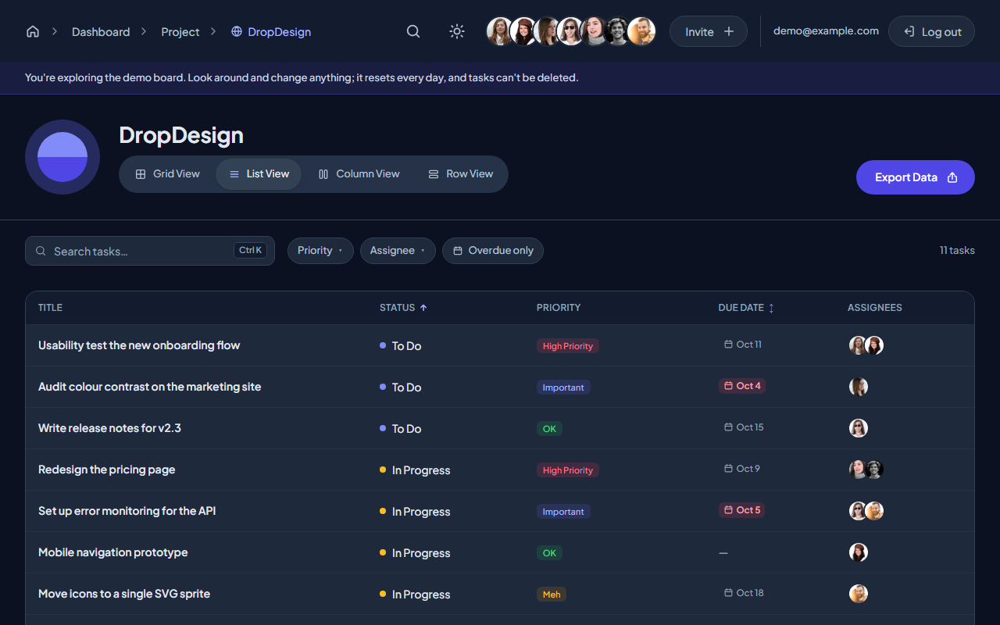

# DropDesign

[](https://github.com/fichin/dropdesign/actions/workflows/ci.yml)

A full-stack Kanban board for small teams: drag tasks between columns, track progress and
due dates, discuss tasks in comments, and find anything with search and filters. React +
TypeScript on the front, Express + PostgreSQL behind it, with accounts, light and dark
themes, and an accessibility pass on every screen.

## Live demo

**[dropdesign-ashy.vercel.app](https://dropdesign-ashy.vercel.app)**: click **Try Demo** on the login page to go straight
to a sample board, no account needed. Or log in with:

| Email | Password |
|---|---|
| `demo@example.com` | `try-dropdesign` |

The demo board is shared by everyone and resets every day at 04:00 UTC; the demo account
can change anything except delete tasks.


## Features

- **Kanban board**: three columns, drag-and-drop with mouse, touch (press and hold) or keyboard (Space, arrows, Space)
- **Four views** of the same board, remembered across visits: **Grid** (the kanban), **List** (a table sortable by status and due date), **Column** (columns stacked full width, good on phones) and **Row** (each column as a horizontal lane). Search and filters apply in every view; drag-and-drop works in Grid, Column and Row
- **Task details**: title, description, status, priority, assignees, due dates with overdue highlighting, delete with confirmation
- **Comments** on every task, shown instantly while they save
- **Search and filters**: live search with highlighted matches, priority/assignee/overdue filters, <kbd>Ctrl</kbd>+<kbd>K</kbd> or <kbd>/</kbd> to search
- **Accounts**: register and log in, or **Try Demo** with one click; sessions in an httpOnly cookie
- **Optimistic saving**: changes appear immediately and are saved in order; if the server rejects one, the board reloads and says why
- **Offline copy**: the last saved board stays viewable (read-only) when the server can't be reached
- **Dark mode**: follows the system setting until you choose, remembers the choice, no flash on load
- **Accessibility**: text and placeholder contrast measured at WCAG AA in both themes, screen reader announcements for drag-and-drop, focus handled in dialogs, menus and full-page messages
- **Friendly edge cases**: a loading skeleton, empty states (empty column, empty board, no search results), a 404 page, and an error page with a reload button if something breaks
- **Responsive** down to 360px phones, and **Export** of the board as JSON

## Screenshots

| | Board | Log in |
|---|---|---|
| **Light** |  |  |
| **Dark** |  |  |

The List view, sortable by status and due date:



## Tech stack

| | |
|---|---|
| **Frontend** | React 19, TypeScript, Vite, dnd-kit, plain CSS with design tokens |
| **Backend** | Node 24, Express 5, PostgreSQL (`pg`), zod validation, bcrypt, JWT (jose) |
| **Tests** | Vitest + React Testing Library (frontend), `node:test` against a real database (backend) |
| **Tooling** | oxlint, SQL migrations, a shared `shared/` folder for types used by both sides |

## Running locally

You need **Node 24+** and a **PostgreSQL** database. A free [Neon](https://neon.tech)
project works, as does a local Postgres.

```bash
git clone https://github.com/fichin/dropdesign.git
cd dropdesign

# 1. Backend: configure, create the tables, load the sample board, start the API (port 3001)
cd backend
npm install
cp .env.example .env        # then fill in the values below
npm run migrate
npm run seed
npm run dev

# 2. Frontend, in a second terminal from the project root (port 5173)
npm install
npm run dev
```

Open http://localhost:5173 and create an account. In development, Vite forwards `/api`
to the backend, so no CORS setup is needed.

**Backend environment** (`backend/.env`, never committed; `.env.example` explains each one):

| Variable | What it is |
|---|---|
| `DATABASE_URL` | PostgreSQL connection string |
| `JWT_SECRET` | Random string (32+ characters) that signs session cookies |
| `TEST_DATABASE_URL` | Database for the backend tests (each run uses its own throwaway schema) |
| `PORT`, `CORS_ORIGIN`, `NODE_ENV` | Defaults work locally: `3001`, `http://localhost:5173`, `development` |
| `CRON_SECRET` | Optional: enables the daily demo reset endpoint |

The frontend needs no configuration locally. To try the demo account locally, run
`npm run demo:reset` in `backend/` (note: it replaces the board with the demo board).

## Deployment

The live site runs on Vercel as one project: the frontend as static files and the Express
API as a single serverless function on the same domain (so the session cookie is
first-party), with the database on Neon.

```bash
npm run build:vercel                    # builds .vercel/output: static site + bundled API
npx vercel deploy --prebuilt --prod     # needs a linked project (npx vercel link)
```

Production environment variables on Vercel: `DATABASE_URL` (Neon's pooled connection
string), `JWT_SECRET`, `CRON_SECRET`, `NODE_ENV=production` and `CORS_ORIGIN` (the site's
URL). Vercel's cron calls `/api/demo/reset` daily. For a new database, run the migrations
and `npm run demo:reset` against it first.

## Tests

```bash
npm test                 # frontend: 173 tests (Vitest)
npm run coverage         # with a coverage report (about 84% of lines)
cd backend && npm test   # backend: 69 tests against TEST_DATABASE_URL
```

CI ([`.github/workflows/ci.yml`](.github/workflows/ci.yml)) runs on pushes to `main` and
`feature/**` branches and on pull requests to `main`: lint, the frontend tests and the
production build, plus the backend type-check and tests against a Postgres service container.

The frontend tests focus on behaviour that's easy to break without noticing: the save queue
and rollback, theme persistence (including the no-flash script in `index.html`), filters in
every view, drag-and-drop state, the task modal and comments, routing and the 404 page, the
error boundary, and the loading and empty states.

## Project layout

```
src/            React app: components/, state/ (reducer, sync, filters, theme), api/
backend/        Express API, SQL migrations, demo data, tests (details in backend/README.md)
scripts/        build-vercel.mjs: the production build for Vercel
shared/         Types and sample data used by both
docs/           Demo GIF and screenshots
```

## Not built yet

- **Live updates**: other people's changes appear when you reload (no websockets yet)
- **Invite**: shown in the top bar, not wired up
- **Password reset**
