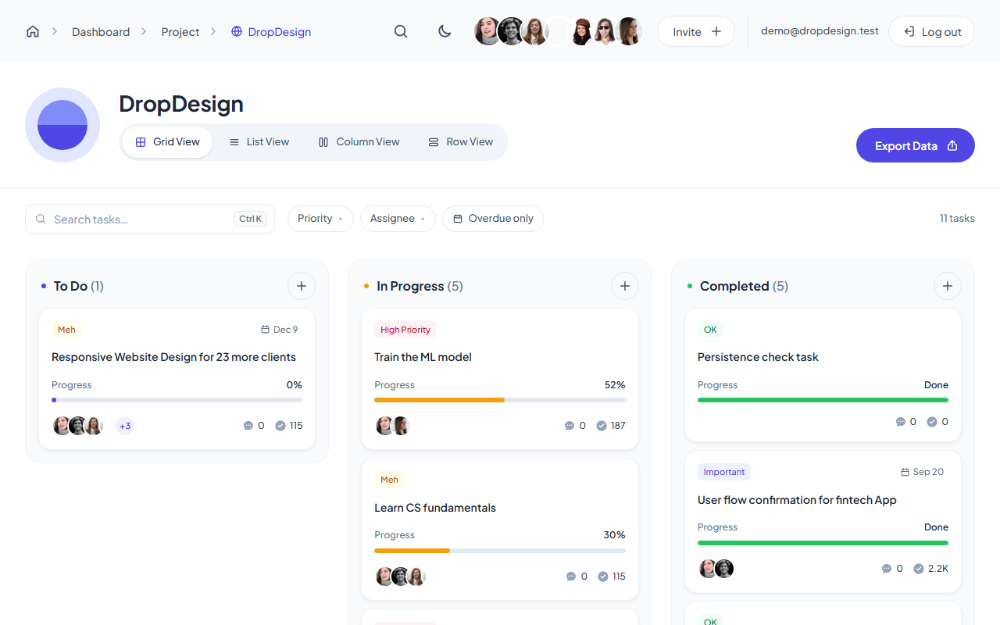
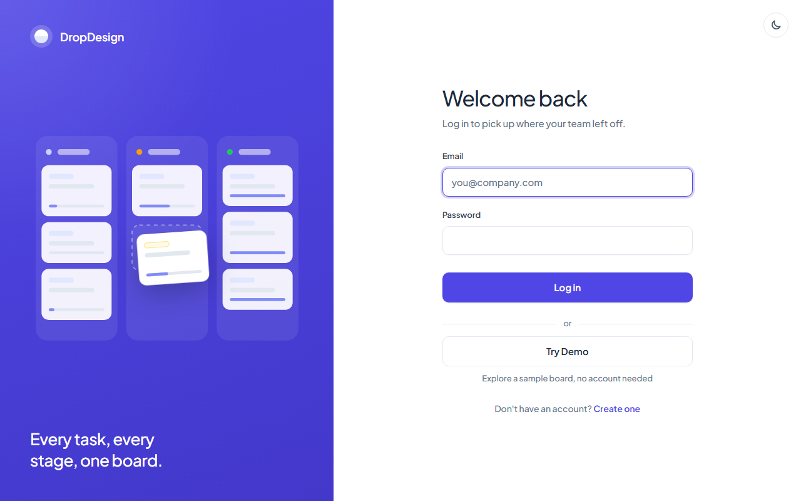
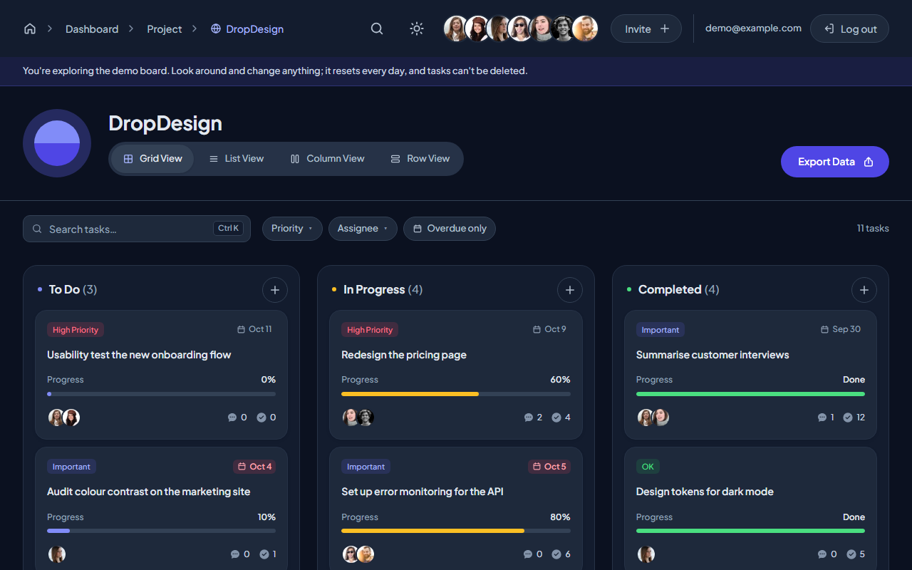
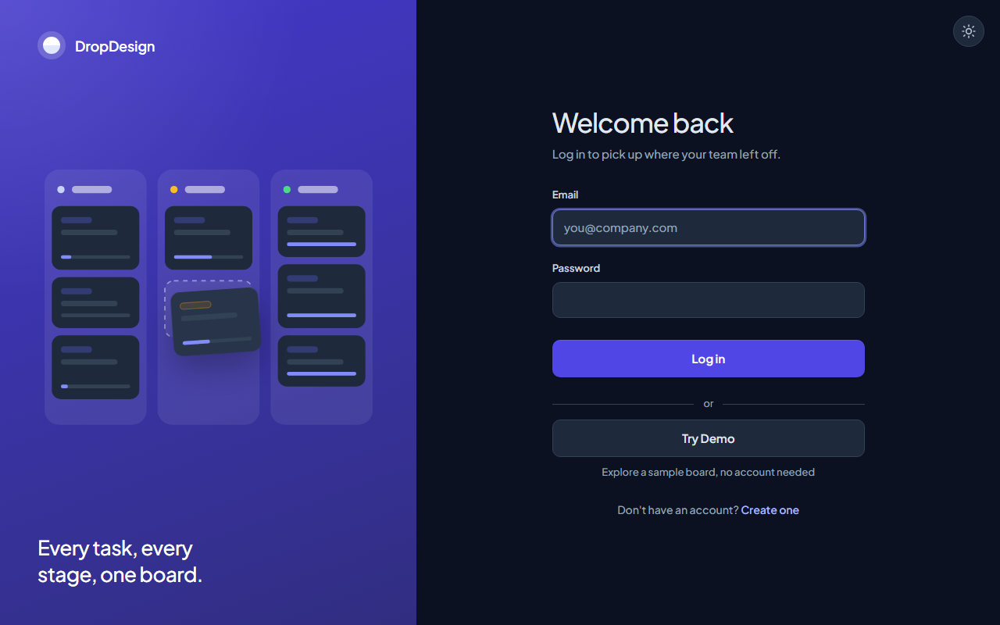
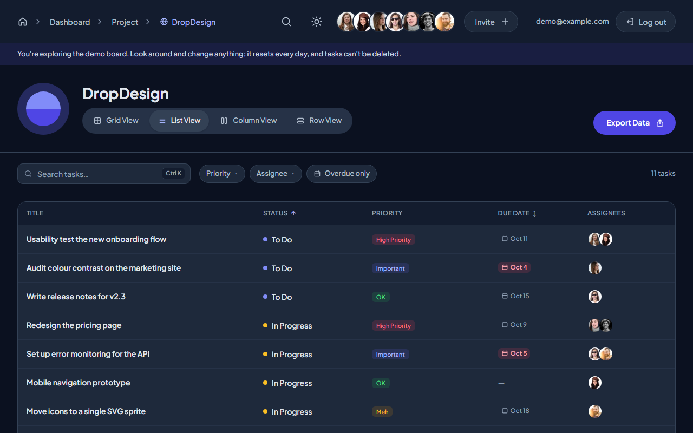
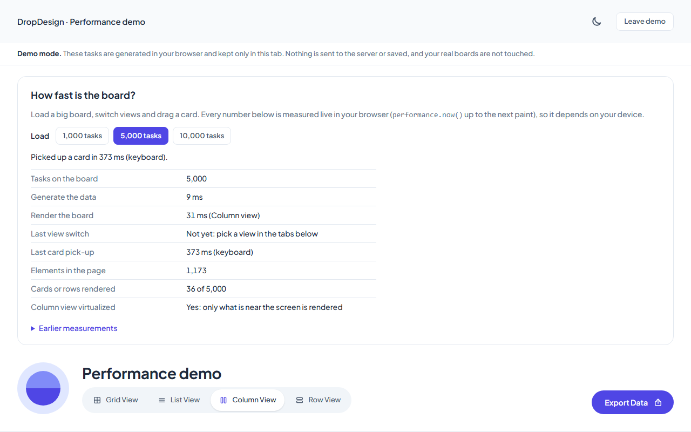
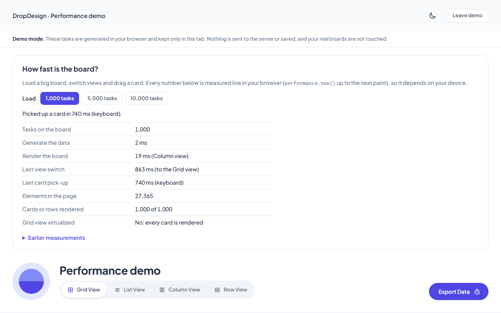

# DropDesign

[](https://github.com/fichin/dropdesign/actions/workflows/ci.yml)

A full-stack Kanban board for small teams: drag tasks between columns, track progress and
due dates, discuss tasks in comments, and find anything with search and filters. React +
TypeScript on the front, Express + PostgreSQL behind it, with accounts, light and dark
themes, and an accessibility pass on every screen.

## Live demo

**[dropdesign-ashy.vercel.app](https://dropdesign-ashy.vercel.app)**: click **Try Demo** on the login page to go straight
to a sample board, no account needed. Or log in with:

| Email | Password |
|---|---|
| `demo@example.com` | `try-dropdesign` |

The demo board is shared by everyone and resets every day at 04:00 UTC; the demo account
can change anything except delete tasks.


## Features

- **Kanban board**: three columns, drag-and-drop with mouse, touch (press and hold) or keyboard (Space, arrows, Space)
- **Four views** of the same board, remembered across visits: **Grid** (the kanban), **List** (a table sortable by status and due date), **Column** (columns stacked full width, good on phones) and **Row** (each column as a horizontal lane). Search and filters apply in every view; drag-and-drop works in Grid, Column and Row
- **Task details**: title, description, status, priority, assignees, due dates with overdue highlighting, delete with confirmation
- **Comments** on every task, shown instantly while they save
- **Search and filters**: live search with highlighted matches, priority/assignee/overdue filters, <kbd>Ctrl</kbd>+<kbd>K</kbd> or <kbd>/</kbd> to search
- **Accounts**: register and log in, or **Try Demo** with one click; sessions in an httpOnly cookie
- **Optimistic saving**: changes appear immediately and are saved in order; if the server rejects one, the board reloads and says why
- **Offline copy**: the last saved board stays viewable (read-only) when the server can't be reached
- **Dark mode**: follows the system setting until you choose, remembers the choice, no flash on load
- **Accessibility**: text and placeholder contrast measured at WCAG AA in both themes, screen reader announcements for drag-and-drop, focus handled in dialogs, menus and full-page messages
- **Friendly edge cases**: a loading skeleton, empty states (empty column, empty board, no search results), a 404 page, and an error page with a reload button if something breaks
- **Responsive** down to 360px phones, and **Export** of the board as JSON

## Screenshots

| | Board | Log in |
|---|---|---|
| **Light** |  |  |
| **Dark** |  |  |

The List view, sortable by status and due date:



## Performance case study

**Try it: [dropdesign-ashy.vercel.app/perf](https://dropdesign-ashy.vercel.app/perf)**, no account needed. It fills a board
with 1,000, 5,000 or 10,000 generated tasks, in your browser only (nothing is sent to the server or saved), and
measures render time, view switches, elements in the page and card pick-up live on your device.

**The problem.** With 5,000 tasks every card was in the page: about 160,000 elements and 110 MB of JavaScript heap.
Picking up a card to drag it froze the page for about 17 seconds.

**What changed.** The cards and columns were memoized, so one change no longer re-renders the whole board (#11).
Then the List view (#13) and the Column view (#15) were virtualized: they render only the rows and cards near the
screen, using `@tanstack/react-virtual`. In long columns, keyboard drag-and-drop still reaches cards that are scrolled
out of view, the focused card stays rendered, and screen readers still hear each card's position
(`aria-setsize`/`aria-posinset`).

**Before and after**, with 5,000 tasks in the Column view. Each number is the median of 3 runs, alternating between
the two versions. The measurements come from a production build in Chrome (Playwright, 1440×900, no CPU slowdown,
API mocked). Interaction times are Event Timing durations, the measurement behind INP:

| 5,000 tasks, Column view | Before (main before #15) | After (#15) |
|---|---|---|
| First render | 6,687 ms | 772 ms |
| Elements in the page | 159,289 | 1,415 |
| JavaScript heap | 111 MB | 9 MB |
| Type in search | 960 ms | 56 ms |
| Open a card | 920 ms | 88 ms |
| Pick up a card (keyboard)* | 16,992 ms | 488 ms |
| Drop it | 3,600 ms | 88 ms |

\* From a second set of 3 alternating runs that waited up to 20 s per interaction: the first set waited 1.5 s, and
picking up a card took longer than that before the change.

In the List view (#13), switching to the list with 5,000 tasks went from 2,472 ms to 464 ms, and the list went from
104,277 elements to 572.



**Not done yet.** The Grid and Row views still render every card. In the demo they show up to 1,000 tasks, and the
panel says so. Switching to the Grid view with 1,000 tasks put 27,365 elements in the page:



The panel's numbers come from `performance.now()` up to the next paint (render and view switches), and from the input
event's timestamp to the first paint of the lifted card (pick-up). They depend on the device and browser, so they won't
match the table above exactly.

## Tech stack

| | |
|---|---|
| **Frontend** | React 19, TypeScript, Vite, dnd-kit, plain CSS with design tokens |
| **Backend** | Node 24, Express 5, PostgreSQL (`pg`), zod validation, bcrypt, JWT (jose) |
| **Tests** | Vitest + React Testing Library (frontend), `node:test` against a real database (backend) |
| **Tooling** | oxlint, SQL migrations, a shared `shared/` folder for types used by both sides |

## Running locally

You need **Node 24+** and a **PostgreSQL** database. A free [Neon](https://neon.tech)
project works, as does a local Postgres.

```bash
git clone https://github.com/fichin/dropdesign.git
cd dropdesign

# 1. Backend: configure, create the tables, load the sample board, start the API (port 3001)
cd backend
npm install
cp .env.example .env        # then fill in the values below
npm run migrate
npm run seed
npm run dev

# 2. Frontend, in a second terminal from the project root (port 5173)
npm install
npm run dev
```

Open http://localhost:5173 and create an account. In development, Vite forwards `/api`
to the backend, so no CORS setup is needed.

**Backend environment** (`backend/.env`, never committed; `.env.example` explains each one):

| Variable | What it is |
|---|---|
| `DATABASE_URL` | PostgreSQL connection string |
| `JWT_SECRET` | Random string (32+ characters) that signs session cookies |
| `TEST_DATABASE_URL` | Database for the backend tests (each run uses its own throwaway schema) |
| `PORT`, `CORS_ORIGIN`, `NODE_ENV` | Defaults work locally: `3001`, `http://localhost:5173`, `development` |
| `CRON_SECRET` | Optional: enables the daily demo reset endpoint |

The frontend needs no configuration locally. To try the demo account locally, run
`npm run demo:reset` in `backend/` (note: it replaces the board with the demo board).

## Deployment

The live site runs on Vercel as one project: the frontend as static files and the Express
API as a single serverless function on the same domain (so the session cookie is
first-party), with the database on Neon.

```bash
npm run build:vercel                    # builds .vercel/output: static site + bundled API
npx vercel deploy --prebuilt --prod     # needs a linked project (npx vercel link)
```

Production environment variables on Vercel: `DATABASE_URL` (Neon's pooled connection
string), `JWT_SECRET`, `CRON_SECRET`, `NODE_ENV=production` and `CORS_ORIGIN` (the site's
URL). Vercel's cron calls `/api/demo/reset` daily. For a new database, run the migrations
and `npm run demo:reset` against it first.

## Tests

```bash
npm test                 # frontend: 209 tests (Vitest)
npm run coverage         # with a coverage report (about 84% of lines)
cd backend && npm test   # backend: 82 tests against TEST_DATABASE_URL
```

CI ([`.github/workflows/ci.yml`](.github/workflows/ci.yml)) runs on pushes to `main` and
`feature/**` branches and on pull requests to `main`: lint, the frontend tests and the
production build, plus the backend type-check and tests against a Postgres service container.

The frontend tests focus on behaviour that's easy to break without noticing: the save queue
and rollback, theme persistence (including the no-flash script in `index.html`), filters in
every view, drag-and-drop state, the task modal and comments, routing and the 404 page, the
error boundary, and the loading and empty states.

## Project layout

```
src/            React app: components/, state/ (reducer, sync, filters, theme), api/, demo/ (/perf)
backend/        Express API, SQL migrations, demo data, tests (details in backend/README.md)
scripts/        build-vercel.mjs: the production build for Vercel
shared/         Types and sample data used by both
docs/           Demo GIF and screenshots
```

## Not built yet

- **Live updates**: other people's changes appear when you reload (no websockets yet)
- **Invite**: shown in the top bar, not wired up
- **Password reset**
- **Virtualized Grid and Row views**: they render every card, so they slow down on very large boards (see the
  [performance case study](#performance-case-study))

## License

[MIT](LICENSE) © Filip Krstev
